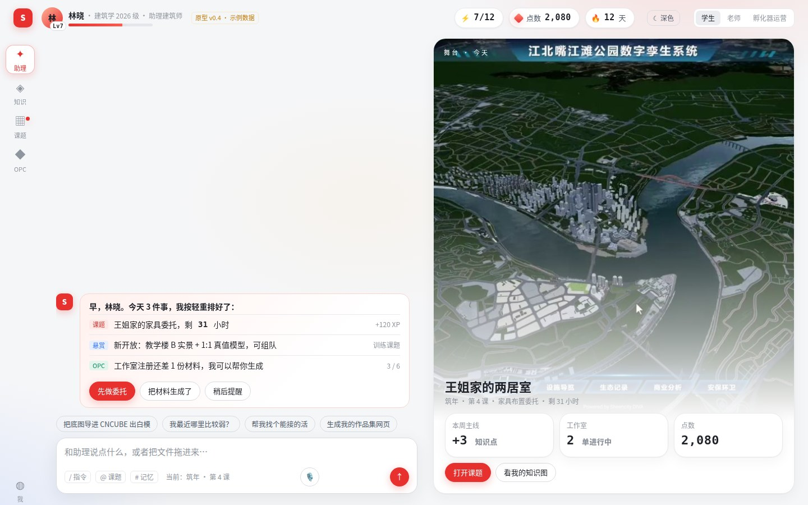
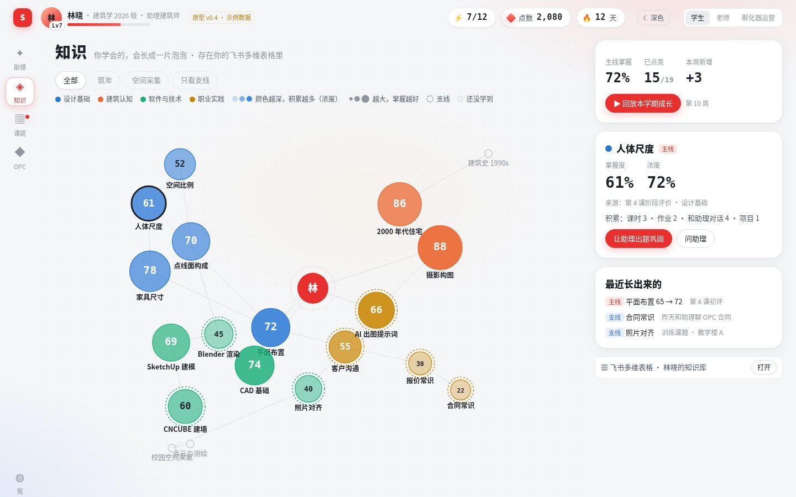
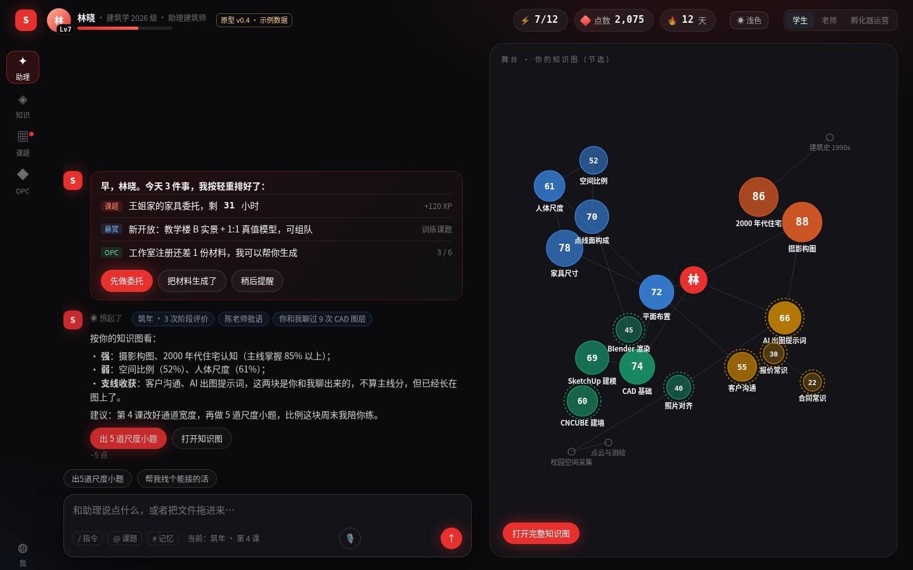

# SheenCity AI 教学平台（SCity）

**一个懂城市更新和空间智能的 AI 助理，陪学生从上学到工作。**

> AI 时代，老师讲的知识学生随手可查。学校真正能交付的，是实践经验和解决问题的能力。

## 这个项目是怎么来的

这个项目由光辉城市创始人、CEO 宋晓宇发起。他不写代码：由他提出需求、做产品判断，AI 编程助手负责设计、编码和测试。我们想证明，借助 AI，不懂技术的人也能做出对教学有影响力的产品。仓库里的每一次提交，都是这个过程的记录。

## 平台包含什么

| 板块 | 一句话 |
| --- | --- |
| **常驻助理** | 每个学生都有一个懂城市更新、空间智能的行业智能体，课题、作品、项目都能直接交给它办，毕业后也能继续用 |
| **知识图** | 学到的知识点长成一片“泡泡”：颜色越深，积累越多；泡泡越大，掌握越好。会随学习不断生长 |
| **课题与作品集** | 学院开设的游戏化课题在这里推进，做出来的东西自动沉淀为网页作品集 |
| **OPC 孵化器** | 面向城市更新、空间智能的产业 OPC（一人公司），提供真实项目和真实交易的实战机会 |

老师和学生使用同一套平台，区别只在课题里的角色。

## 原型

`prototype/v0.4/` 是当前的可点击网页原型（演示数据，非真实功能）：

- 下载仓库后，用电脑浏览器打开 `prototype/v0.4/index.html`；
- 右上角可切换 **学生 / 老师 / 孵化器运营** 三种身份，以及 **浅色 / 深色** 两套界面；
- 知识图页面可拖动泡泡，点“回放本学期成长”查看动态效果。

| 浅色 · 助理 | 浅色 · 知识图 | 深色 · 助理 |
| --- | --- | --- |
|  |  |  |

## 当前进度

- [x] 产品框架与原型（v0.1 → v0.4）
- [ ] 技术验证：飞书应用、大模型接入与计量、智能体框架
- [ ] 演示版
- [ ] 试点版

技术方向：依托飞书开放平台开发；智能体框架计划采用开源的 VeADK；能力以 MCP 工具和 Skill 的方式组织。

## 版权说明

本仓库暂未附带开源许可证，在许可证发布之前，保留所有权利。
原型中的项目图片、品牌与标志归光辉城市（重庆）科技有限公司所有，仅用于展示开发过程。
